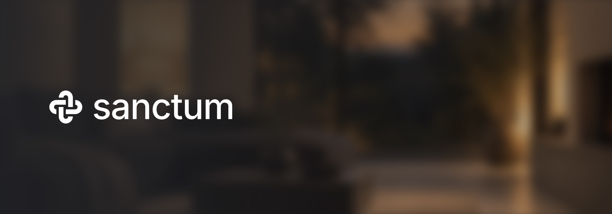
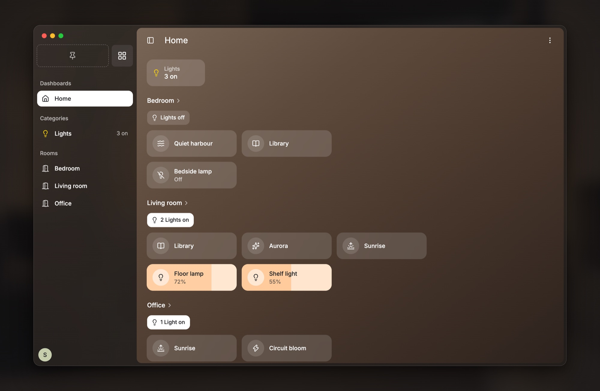
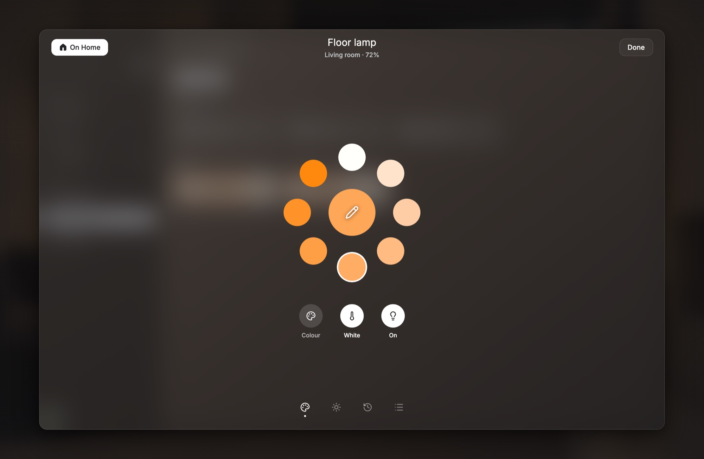

<p align="center">
  
</p>

<h3>Home automation that stays at home.</h3>

Sanctum runs your home's lights, sensors and automations on a small computer
in your home, such as a Raspberry Pi. It works without the internet and needs
no cloud account: your devices, automations and data stay at home, under your
control. Everyone in the household sees and does the same, from the Mac app
on their own Mac or on one the whole household shares.



## What it does today

**Lights and moods**

- Switch and dim lights from their tiles, and set colour, white and
  brightness from a light's page.
- Moods for every room, ready-made smart moods among them, previewed live as
  you edit them.
- Schedules that bring on a room's moods at the times you choose.
- Natural light: lights that follow the sun's colour and brightness through
  the day, and step aside when someone sets them by hand.
- A room's lights come back the way they were when it turns on again.



**Devices**

- Pair Zigbee lights, plugs, switches, remotes and motion, temperature,
  humidity and light-level sensors from Settings.
- Choose what each button on a remote does; a new remote works from its
  first press.
- Firmware updates, a connection check and battery levels, gathered in
  Maintenance.
- Needs attention lists devices that dropped off, went offline or have no
  room, each with its fix.

**Automations**

- Automations that read as sentences: When, And, Then, with motion, light
  level, buttons, readings, times and days.
- Each automation's runs, step by step.

**Your home at a glance**

- A Home dashboard with your rooms, and pages for every room and for Lights,
  Switches, Environment, Presence and Buttons.
- What the sensors read, where there's motion and how many lights are on, at
  the top of every dashboard.
- A day and a week of history for every light, switch and sensor.
- The weather and sun times for where your home is.
- An activity log of what changed, and who or what changed it.

**Looks after itself**

- Updates from Settings, backed up first and rolled back when a new version
  isn't healthy.
- A status page for storage, memory, temperature and the network, with
  Restart, Shut down and Free up space.
- HTTPS on your home network, with your home's own certificate authority.
- The Mac app finds your home on the network and pairs with a code, for one
  person or as a device the household shares.

## Coming soon

- More kinds of Zigbee devices, such as contact sensors and covers
- Choosing your Zigbee stick in Settings
- Day and Evening themes
- Dashboards you can arrange yourself
- A signed Mac app

## Try it

Sanctum runs on a Raspberry Pi 4 or another 64-bit Linux machine, with a
Zigbee USB stick for your devices and the Mac app to use it from.

1. Put Raspberry Pi OS Lite (64-bit) on the Pi with Raspberry Pi Imager. A
   machine that already runs Debian or Ubuntu can skip this step.
2. On it, run:

   ```sh
   curl -fsSL https://raw.githubusercontent.com/meetsanctum/sanctum/main/deploy/install.sh | sudo bash
   ```

3. Plug in the Zigbee stick.
4. Build the Mac app and open it. It finds your home on the network, and you
   set it up from there.

[The install guide](docs/install.md) has each step in full. The Mac app has
no download: it is built from this repository, on a Mac with Apple silicon.

## Licences

Copyright © 2026 Sanctum. Sanctum's code is open source under two
licences:

- **The product** is under the
  [GNU Affero General Public License, version 3 only](LICENSE)
  (`AGPL-3.0-only`): the core, the manager, the client, the desktop app, the
  website, `deploy/`, and anything else not in a package with a licence of
  its own.
- **What apps build on** is under the
  [Apache License 2.0](packages/app-sdk/LICENSE) (`Apache-2.0`): every
  package in `packages/` and every app in `catalog/apps/`, each with its own
  `LICENSE`. Apps for Sanctum can use the SDKs whatever their own licence,
  without taking on the AGPL.

The brand is not open source:

- **The name Sanctum and its logo** are trademarks
  ([TRADEMARKS.md](TRADEMARKS.md)), so a fork needs a name and logo of its
  own. The knot is drawn in code too (`apps/client/src/knot.ts`,
  `apps/desktop/scripts/artwork.ts`); that code is under the AGPL, but the
  knot stays a trademark however it is drawn.
- **The brand's files** live only in [`assets/brand`](assets/brand/README.md),
  the `@meetsanctum/brand` package, under
  [a licence of their own](assets/brand/LICENSE): the logo, the app icons,
  the desktop app's icon and the brand's photos. You may use them unmodified
  to build and run Sanctum, and for little else without asking.

Files from others keep their own licences, as the backdrops in
`apps/client/src/backdrops` do: photos from Unsplash under the
[Unsplash License](https://unsplash.com/license), credited in
[their README](apps/client/src/backdrops/README.md).
