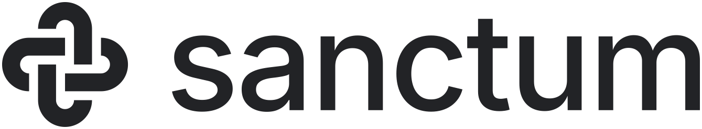

# Sanctum brand

The brand's files, as the `@meetsanctum/brand` package: the logo, the
[app icons](app-icons/README.md), the desktop app's icon and the brand's
photos. They are not open source: [their licence](LICENSE) lets anyone use
them unmodified to build and run Sanctum, and the name and logo are
trademarks ([TRADEMARKS.md](../../TRADEMARKS.md)). Code takes them from here,
and nothing else in the repository keeps a copy.

The logo pairs a geometric Solomon's knot with the name set in Inter Medium in
lower case: "sanctum". In running text the name stays "Sanctum".

## Files

| File                              | Size        | Use                                                           |
| --------------------------------- | ----------- | ------------------------------------------------------------- |
| `sanctum-logo.svg`                | 512 × 92    | Horizontal lockup.                                            |
| `sanctum-logo-white.svg`          | 512 × 92    | Horizontal lockup in White.                                   |
| `sanctum-logo-stacked.svg`        | 388 × 347   | Stacked lockup with the line "Home OS".                       |
| `sanctum-logo-stacked-white.svg`  | 388 × 347   | Stacked lockup in White.                                      |
| `sanctum-mark.svg`                | 14 × 14     | The knot alone, on its grid; drawn 280 px by default.         |
| `sanctum-mark-white.svg`          | 14 × 14     | The knot alone in White.                                      |
| `sanctum-favicon.svg`             | 16 × 16     | Favicon: the knot at 14 px, in White where it is dark.        |
| `sanctum-logo-carbon.png`         | 1339 × 248  | Horizontal lockup in Carbon, for White.                       |
| `sanctum-logo-white.png`          | 1339 × 248  | Horizontal lockup in White, for Carbon.                       |
| `sanctum-logo-stacked-carbon.png` | 723 × 648   | Stacked lockup in Carbon.                                     |
| `sanctum-logo-stacked-white.png`  | 723 × 648   | Stacked lockup in White.                                      |
| `sanctum-mark.png`                | 1024 × 1024 | The knot in Carbon, 812 px across in a square canvas.         |
| `sanctum-mark-white.png`          | 1024 × 1024 | The knot in White, 812 px across in a square canvas.          |
| `sanctum-app-icon.png`            | 1024 × 1024 | App icon: the White knot on Carbon as on any tile.            |
| `sanctum-macos-icon.svg`          | 1024 × 1024 | The macOS app icon: the knot on a Carbon squircle.            |
| `sanctum-macos-icon.icns`         | 64 to 1024  | The desktop app's icon, drawn like the SVG.                   |
| `photos/living-room-dusk.jpg`     | 1254 × 1254 | The website's backdrop, generated for the brand guide.        |
| `readme-hero.jpg`                 | 2000 × 700  | The README's hero: the logo over that photo, lightly blurred. |

The PNGs have transparent backgrounds except the app icon, which fills its
square so each platform can apply its own mask. On macOS, whose classic icons
carry their own shape, the desktop app uses `sanctum-macos-icon.svg`: a Carbon
squircle 824 units across on the 1024 grid. The White files are for Carbon
backgrounds; on a White page they are invisible.

## Colourways

The logo is always a single colour, on one of the two brand backgrounds,
with one exception in the product (see Usage).

| Colourway       | Values                 | Use                            |
| --------------- | ---------------------- | ------------------------------ |
| White on Carbon | `#FFFFFF` on `#222326` | Primary: screens, packaging.   |
| Carbon on White | `#222326` on `#FFFFFF` | Light grounds, letters, print. |

## Construction

- **Knot:** two interlaced stadium loops on a 14-unit grid, one upright and
  one lying down. Each loop is 6 × 14 units: 2-unit bands around a 2-unit
  opening, so band, opening and band are equal. The loops cross 4 units in
  from each end. Each band passes under the other loop once, cut 1 unit,
  half a band, short on each side; the cut ends are flat and meet the loop's
  curve. The upright loop passes under at top left and bottom right, the
  lying one at top right and bottom left.
- **Pixels:** every edge lies on the grid, so at a whole number of pixels per
  unit (14, 28, 42 px and so on) the knot is crisp on a 1× screen. Draw it at
  those sizes on screens; the product uses 28 px.
- **On a tile** (an app icon): the knot is 14 units of a tile 26 units across,
  6 units of margin on each side, rounded to whole pixels per unit.
- **Wordmark:** "sanctum" in Inter Medium, letter-spacing −2%, with no
  capitals.
- **Horizontal lockup:** the knot is 1.27 × the font's cap height and sits
  0.35 knot to the left of the wordmark, centred on the word from the
  baseline to the top of the t, so it overhangs both by the same amount. On
  screen it is the 28 px knot beside the name at 30 px.
- **Stacked lockup:** the knot is 2.3 × the cap height and sits 0.28 knot above
  the x-height. "Home OS" is Inter Medium at 0.37 × the wordmark size, 0.7 cap
  heights below the baseline.
- **Clear space:** half the knot's height on every side.
- **Minimum size:** the lockup is never narrower than 120 px on screen or
  30 mm in print. The knot alone goes down to 14 px, one pixel to a unit.

## Usage

- Use Carbon on White and White on Carbon. No other backgrounds, except
  White on the blurred blue backdrop of the screens before the dashboard
  , where the blue deepens
  behind the logo so it keeps at least 3 : 1.
- The SVGs use `currentColor`. The plain files default to Carbon `#222326`
  and the `-white` ones to White, so either works as an image. Inline them
  and set the CSS `color` to switch; the product inlines the knot from
  `apps/client/src/knot.ts`, the same path as `sanctum-mark.svg`.
- Where a service asks for a square logo or avatar (Linear, GitHub, Slack),
  upload `sanctum-app-icon.png`: it carries its own Carbon ground, so it
  reads in light and dark themes alike. Use a transparent White file only
  on a Carbon background.
- Do not stretch the logo, colour its parts differently, use app colours, add
  glows, shadows or textures, capitalise the name or set it in another
  typeface.

## How the files were made

- Every logo file here is drawn from one geometry,
  `apps/desktop/scripts/artwork.ts`, by
  `pnpm --filter @meetsanctum/desktop artwork` on a Mac: the marks, the
  favicon, the knot in each lockup, the PNGs (with AppKit), and the desktop
  app's icon. Its tests check that the client's knot, the website's and every
  lockup's are the one it draws.
- The wordmark and "Home OS" are Inter Medium (version 4.001, © The Inter
  Project Authors, SIL Open Font License 1.1) converted to outlines with Core
  Text, so the files render without the font installed. The generator keeps
  them and draws only the knot anew.
- The knot was drawn on a 240-unit grid until November 2026, with 28-unit
  bands around a 48-unit opening and 7-unit gaps, with a version fitted to
  25 px for screens and a simplified two-loop mark for 16 to 24 px. The
  tighter knot, first drawn for the Mac app's icon, replaced all three; they
  remain in the git history.
- This replaces the first lockup: a potrace trace of a heavier knot with bold
  custom capitals. Its artwork (`sanctum-logo.png`, `sanctum-logo-trimmed.png`,
  the first `sanctum-logo-white.png` and the traced SVGs) remains in the git
  history.
- The wordmark was "Sanctum" in sentence case until it went lower case; the
  knot kept its size and centres on the whole word. The sentence-case files
  remain in the git history.
