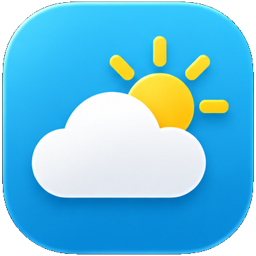

# App icons

The approved 2026-11-03 icon family: mostly opaque foreground symbols,
fine edge highlights, gentle gradients and shallow depth. The PNG masters
are exports of the approved concept artwork, with the presentation labels
and background removed. They have transparent corners and a 256 × 256 px
canvas, enough for the 72 px app overview at 3× density.

Lossless WebP exports sit beside them. The shell's `AppIcon`
(`apps/client/src/app-icon.tsx`) selects artwork by the manifest's glyph and
colour; other pairs keep the standard line icon.

| App           | Glyph         | Colour   | Master                                                      |
| ------------- | ------------- | -------- | ----------------------------------------------------------- |
| Settings      | `settings`    | Graphite |       |
| Moods         | `swatch-book` | Ember    |          |
| Automations   | `sparkles`    | Blossom  |    |
| Weather       | `cloud-sun`   | Sky      |        |
| Natural light | `sun`         | Sun      |  |
| Zigbee        | `radio-tower` | Graphite |         |

Moods owns the colour swatches, Automations the two sparkles.
Zigbee keeps the radio symbol rather than the Zigbee logo, which needs the
Connectivity Standards Alliance's permission.

To regenerate an export from a master, run from the repository root:

```sh
cwebp -lossless -m 6 assets/brand/app-icons/moods.png \
  -o assets/brand/app-icons/moods.webp
```

The WebP pixels, including alpha, match the PNG master. Keep the artwork
itself unchanged when optimizing exports. These are app icons, not launcher
icons for the Sanctum client, which retain the knot.
